<h1>
  Rufin
</h1>
<p align="center">
  <a href="https://matrix.to/#/#rufin:matrix.org"></a>
  <a href="LICENSE"></a>
  <a href="Cargo.toml"></a>
  <a href="https://gstreamer.freedesktop.org/"></a>
  <br>
  <a href="https://flathub.org/apps/io.github.screwys.Rufin"></a>
  <a href="https://aur.archlinux.org/packages/rufin-bin"></a>
  <a href="https://apps.obtainium.imranr.dev/redirect?r=obtainium://app/%7B%22id%22%3A%22io.github.screwys.Rufin%22%2C%22url%22%3A%22https%3A%2F%2Fgithub.com%2Fscrewys%2FRufin%22%2C%22author%22%3A%22screwys%22%2C%22name%22%3A%22Rufin%22%7D"></a>
  <a href="https://hosted.weblate.org/projects/rufin/"></a>
</p>


<p align="left">
  Rufin is a fast, native music player for local folders, network shares and music servers, on <a href="#installation">Linux</a>, <a href="#windows">Windows</a>, <a href="#macos">macOS</a> and <a href="#android">Android</a>. It offers deep customization for its appearance and behavior, rich library browsing and management experience with in-app lyrics/metadata/artwork searching & editing, and a careful playback engine powered by GStreamer.

  Rufin Connect securely syncs your devices and moves playback between them; Rufin can also run headless, be scripted, or be controlled from its Web UI.
</p>

<br clear="all">

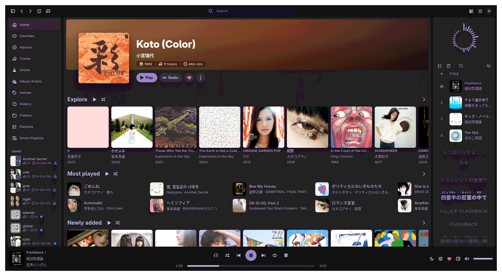

## 📂 Sources

| Source | Favorites, ratings and playlists | Metadata editing | Also |
|---|---|---|---|
| &nbsp;&nbsp;**Local folders** | Kept by Rufin | Written to the files | Folders are watched for changes |
| &nbsp;&nbsp;**WebDAV / Nextcloud** | Kept by Rufin | Written to the files | No mount needed |
| &nbsp;&nbsp;**SMB / Samba** | Kept by Rufin | Written to the files | No mount needed, share discovery |
| &nbsp;&nbsp;**Jellyfin** | On the server | Over the server API | Instant Mix, live library updates |
| &nbsp;&nbsp;**Emby** | On the server; ratings kept by Rufin | Over the server API | Instant Mix, live library updates |
| &nbsp;&nbsp;**Navidrome** / &nbsp;&nbsp;**OpenSubsonic** | On the server | Through matched local files | Radio, public share links |
| &nbsp;&nbsp;**Plex** | On the server; favorites kept by Rufin | Over the server API | Recommendations, Plex Companion, Home profiles |

Downloaded tracks, and tracks of a server matched to local folders, play from disk while activity still goes to the server. You can also configure a local and public adress for a server.

## 🎵 Playback

- **Transitions**: true gapless playback or equal-power crossfade, with an optional fade on play/pause
- **Loudness**: ReplayGain and EBU R128 normalization with true-peak analysis; results can be written to tags
- **Sound**: graphic (10, 18 or 31 bands) and parametric equalizer with saved presets per device and AutoEQ/APO import, crossfeed, playback speed and pitch
- **Output**: audio device selection, multichannel output and Dolby/DTS bitstream passthrough, casting to UPnP and Chromecast
- **Queue**: Auto DJ keeps it filled from server/local recommendations, skip unavailable tracks automatically, sleep timer
- **Formats**: broad codec support [^codecs], and CUE sheets as separate playable tracks

## 📚 Library

- **Browsing**: a customizable Home, Folders, Genres, Moods, History and pins; details pages for tracks, albums and artists
- **Search**: Search within a route or globally, that you can also configure it to search songs by their lyrics
- **Playlists**: mix tracks from different sources, organize playlists in folders, import and export M3U, PLS and XSPF
- **Smart playlists**: rules on metadata, mood/BPM and play/skip history, with custom sorting and limits
- **Recommendations**: track, album, artist, playlist and genre radios from the server or a local fallback
- **Downloads**: manual or through automatic rules, with optional transcoding; downloaded music stays playable offline
- **Metadata**: tag and artwork editor with batch editing, MusicBrainz and AcoustID lookup with on-device fingerprint calculations; missing artwork and lyrics are fetched automatically
- **Lyrics**: synced and word-by-word lyrics with karaoke mode, Furigana/Romaji, translations, online search, editable text and offset; saved to your source as embedded tags or `.lrc` files
- **Activity**: favorites, ratings and listening history; a listening overview you can export as an image, and history as Last.fm/ListenBrainz compatible `.csv`
- **Sharing**: Share server links of your tracks, or share the song or selected lyrics as an elagant card for social media on Android
- **Backups**: granular import/export including credentials; scheduled and password-protected backups
- **Files**: open audio files and playlists as the default player, from the CLI with `rufin track.mp4`, or by dragging them into the window

## ✨ Rufin Connect

- Syncs sources, credentials, playlists, favorites, pins, preferences and listening history between your devices; queues, downloads and local paths stay per device
- Continue playback where another device left off, or control what another device is playing
- Stream your local music library to another device
- Devices pair with emoji verification (like Matrix) and connect over encrypted [Iroh](https://github.com/n0-computer/iroh) links, directly or through a relay you choose; an encrypted sync folder (local, WebDAV or SMB) covers devices that are never online together

## 🧩 Integrations

- **Scrobbling**: Last.fm, Libre.fm and ListenBrainz, with offline storage and automatic retries; Discord Rich Presence
- **System**: media controls (MPRIS with lyrics on Linux), tray icon, running in the background; credentials are kept in the system keyring
- **Private mode**: temporarily pauses external activity
- **Controller**: control playback, browse the library, manage sources and playlists from a browser or the HTTP API, with token authentication; playback stays on the device running Rufin. It also runs without the desktop interface:
```bash
export RUFIN_API_TOKEN="your_token"
rufin --headless --listen
```

## 🖥️ Interface

- **Desktop**: layouts that adapt from a wide window down to a mini player, fullscreen player with visualizer, themes including custom ones, and an extensive keyboard shortcuts catalog.
- **Android**: same core built with Jetpack Compose, is also reliable in multiple layouts beyond the regular vertical screen: landscape mode, foldables, tablets, and TVs. 

# Screenshots

| | |
|:---:|:---:|
| 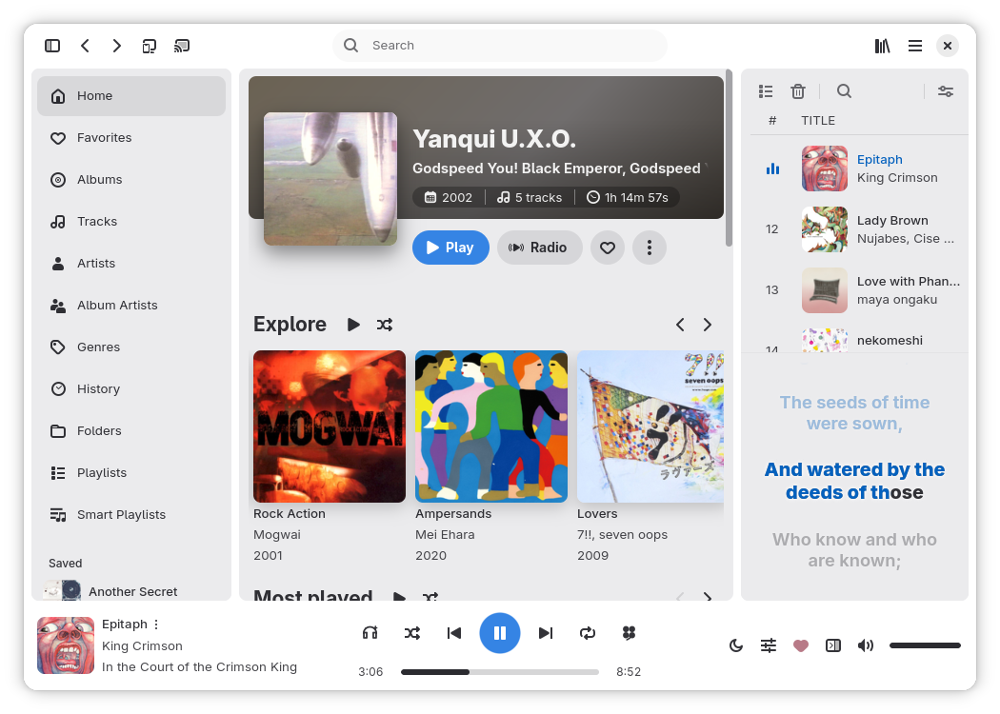 | 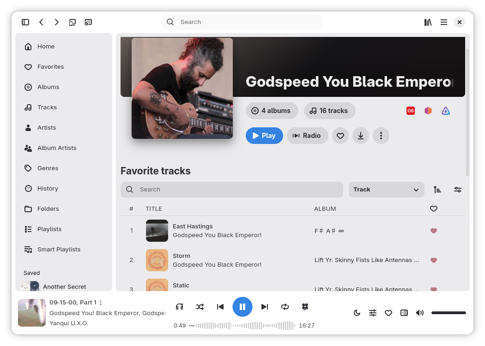 |
| **Home** | **Artist details** |
| 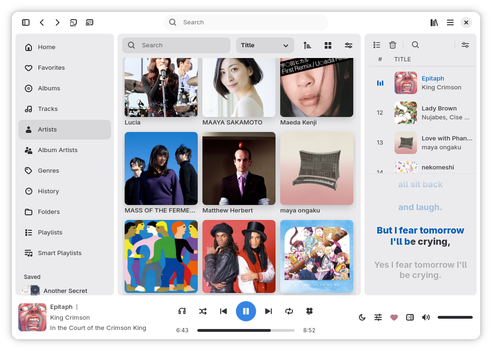 | 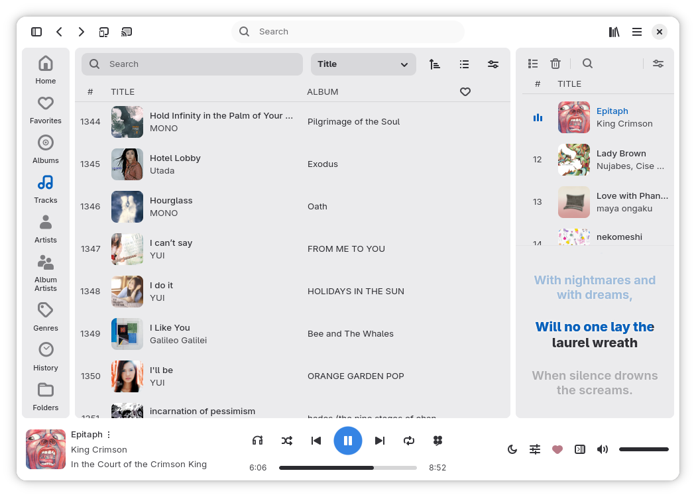 |
| **Artists** | **Compact sidebar** |
| 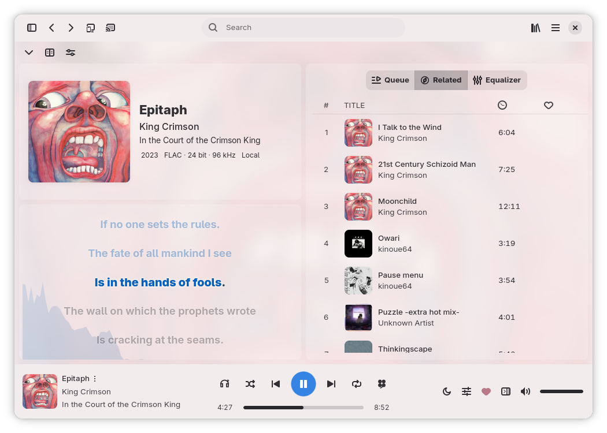 | 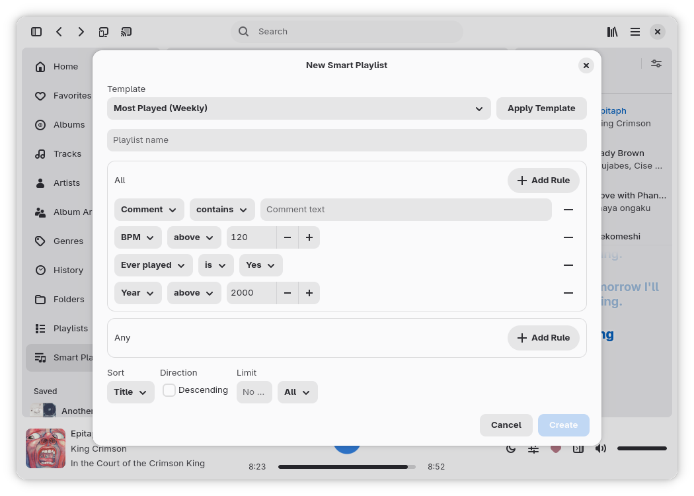 |
| **Fullscreen player** | **Smart playlists** |
| 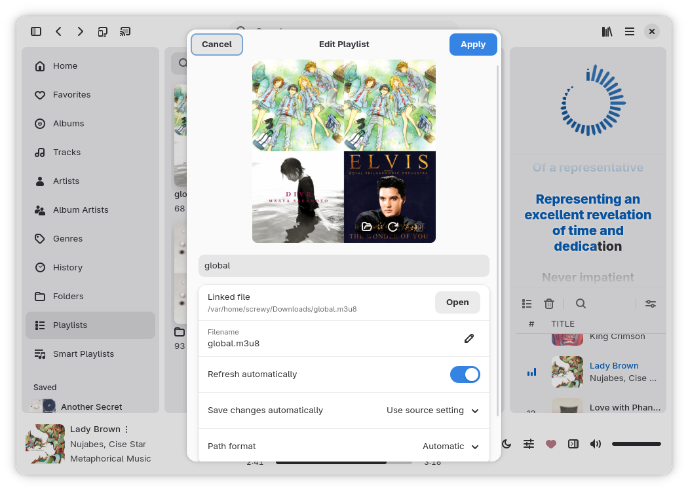 | 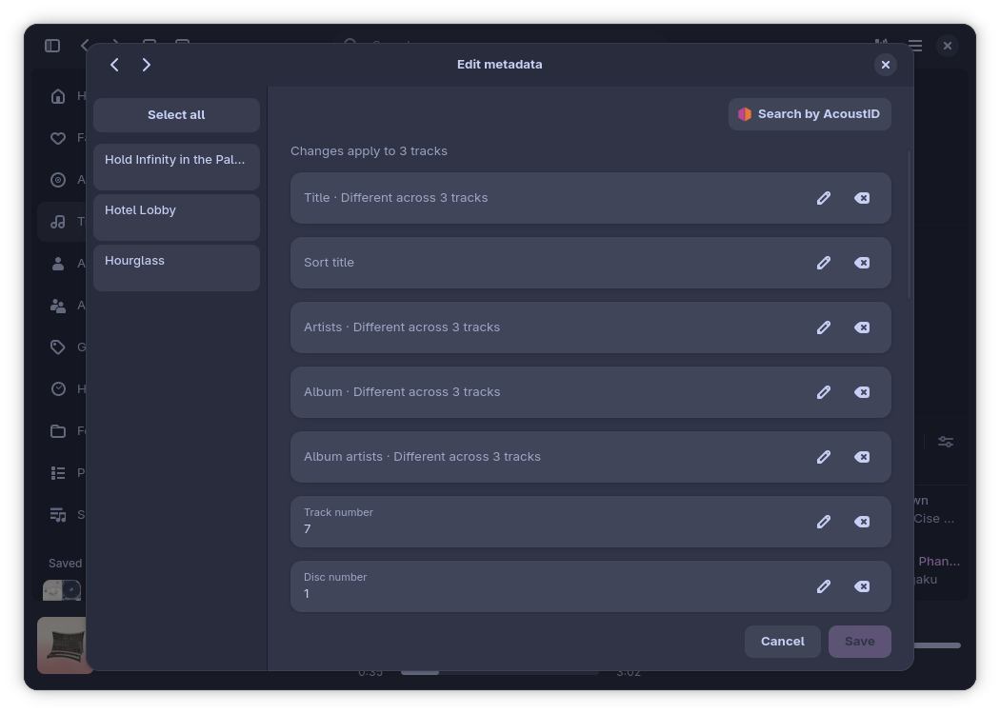 |
| **Playlist settings** | **Metadata editor** |
| 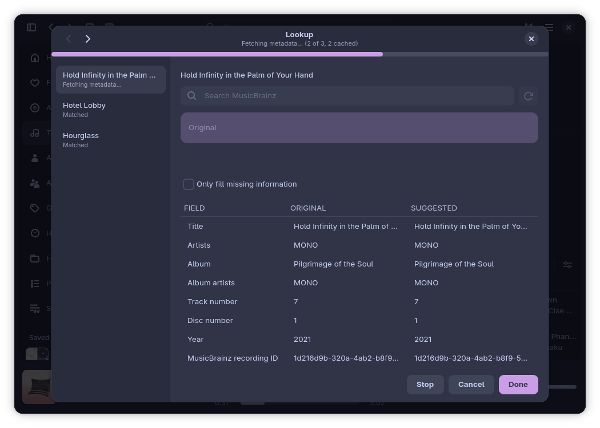 | 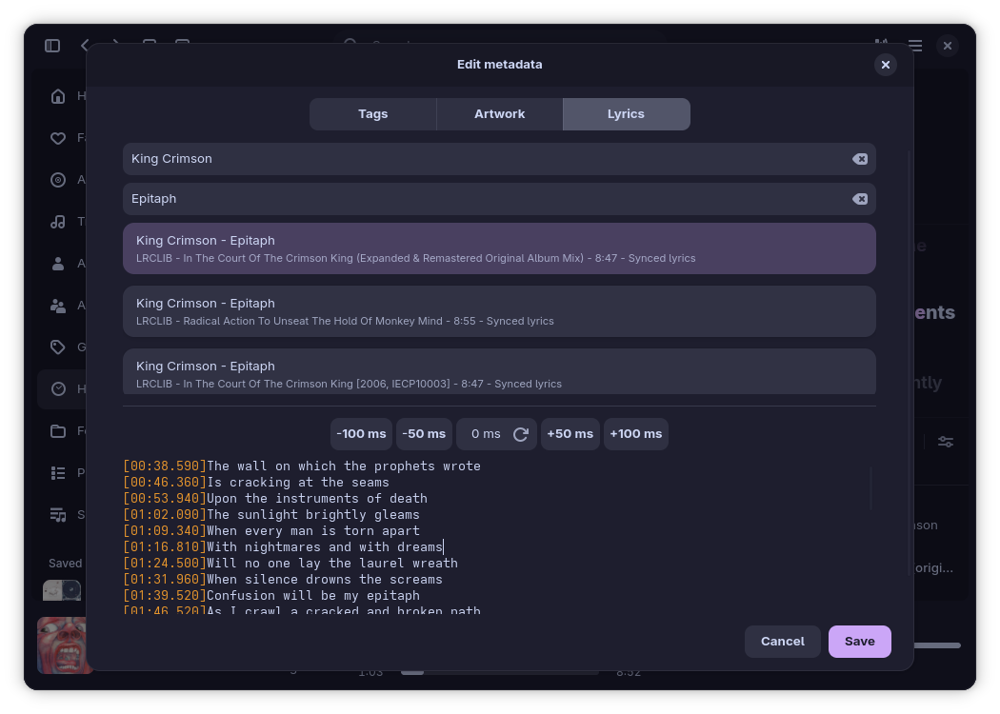 |
| **Metadata lookup** | **Lyrics editor** |
| 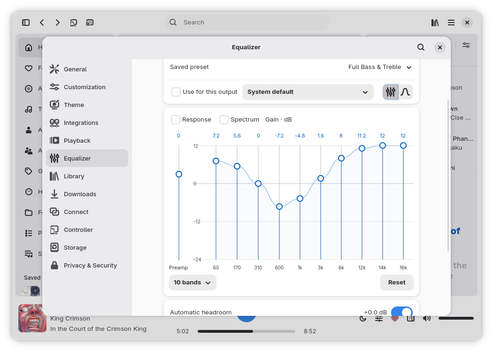 | 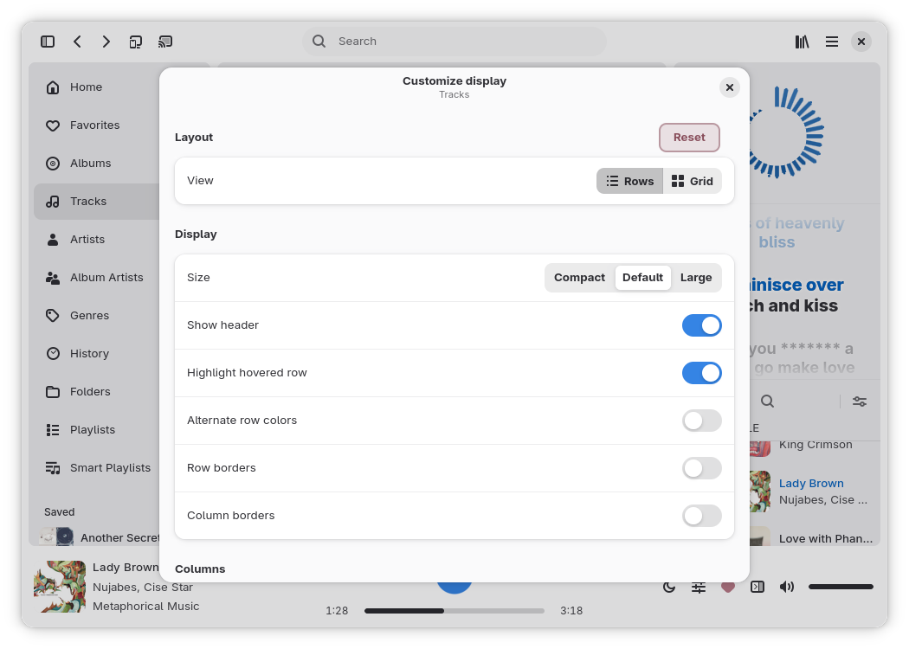 |
| **Equalizer** | **Customize display** |
| 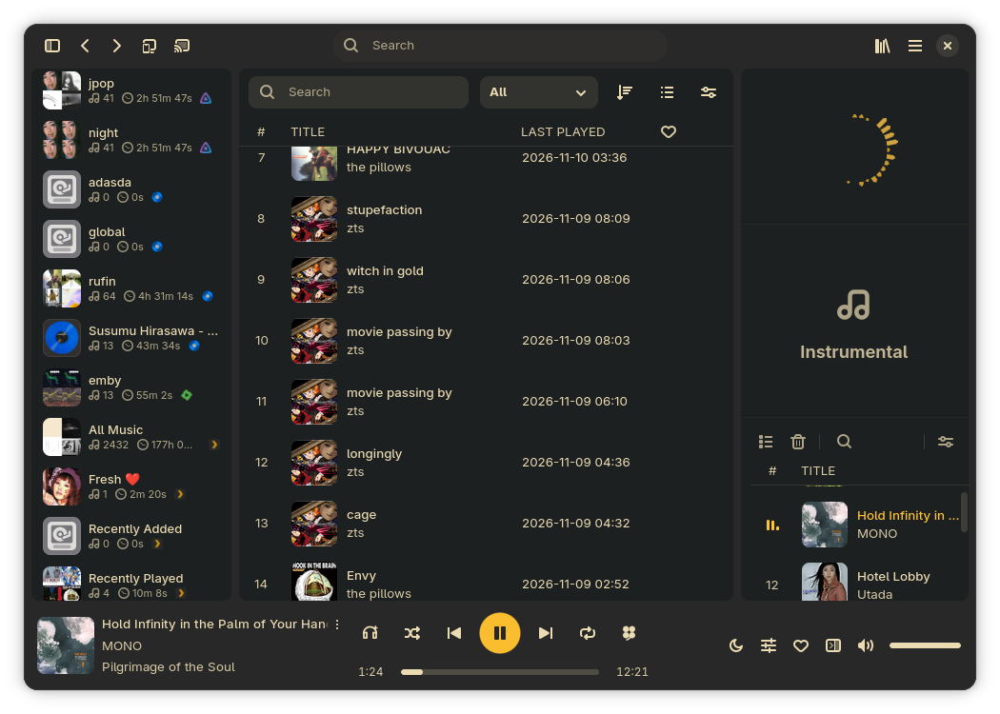 | 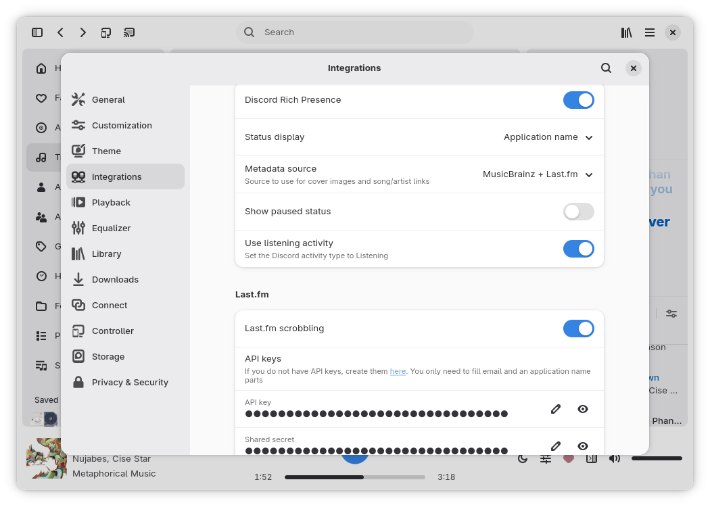 |
| **Rearrangeable layout** | **Integrations** |

# Installation

## Flatpak
<p>
  <a href="https://flathub.org/apps/io.github.screwys.Rufin">
    
  </a>
</p>

## Fedora

Rufin is available for Fedora 44 and 45.

```bash
sudo dnf copr enable screwyy/rufin
sudo dnf install rufin
```

## AUR

Latest binary releases:

```bash
yay -S rufin-bin
```

Building from the source:
```bash
yay -S rufin-git
```


## Nix

Rufin is available in nixpkgs repository. To run Rufin without installing:

```bash
nix run nixpkgs#rufin
```

To add it to your profile:
```bash
nix profile install nixpkgs#rufin
```

You can also run `main` or an older release directly.

```bash
nix run github:screwys/Rufin/main
nix run github:screwys/Rufin/vX.Y.Z
```

## Windows

Download the .exe from [GitHub Releases](https://github.com/screwys/Rufin/releases/latest).

The installer has opt-in **Automatic updates** in General preferences to have Rufin install an
available Windows update when the app starts. Alternatively, you can click `Update` button in
Version History on the latest release.

## macOS

Homebrew Cask is the primary macOS installation:

```bash
brew install --cask screwys/tap/rufin
```

You can turn on **Automatic updates** in General preferences to have
Rufin install an available update when the app starts or manually click `Update` button in Version History on the latest release.

You can also download `.dmg` files directly from
[GitHub Releases](https://github.com/screwys/Rufin/releases/latest), but then you have to update manually.

## Android

<p>
  <a href="https://apps.obtainium.imranr.dev/redirect?r=obtainium://app/%7B%22id%22%3A%22io.github.screwys.Rufin%22%2C%22url%22%3A%22https%3A%2F%2Fgithub.com%2Fscrewys%2FRufin%22%2C%22author%22%3A%22screwys%22%2C%22name%22%3A%22Rufin%22%7D">
    
  </a>
</p>

Rufin for Android is installed and kept up to date with [Obtainium](https://obtainium.imranr.dev/). Open the badge on your
phone, or add `https://github.com/screwys/Rufin` in Obtainium yourself. Android 7.0 or newer is required.

## Building locally

Start by cloning the repository. You can build Rufin natively or use our Linux development container if you want to keep dependencies outside of your system and have Docker or Podman available.

```bash
git clone https://github.com/screwys/Rufin.git
cd Rufin
```

### Development container

```bash
just container setup
just build
```

This makes just commands go through the container development. If you want to build natively instead after running this one, use `just container disable`.

### Native build

Building Rufin requires Rust 1.96 or newer, CMake 3.25 or newer, Ninja,
pkg-config, GTK 4.20 or newer, libadwaita 1.9 or newer, and GStreamer 1.26 or
newer. Packaging and translation checks additionally require `msgfmt` from gettext.

**Arch Linux:**

```bash
sudo pacman -S --needed \
  base-devel rust cargo cmake ninja just pkgconf gettext gtk4 libadwaita \
  gstreamer gst-plugins-base gst-plugins-good gst-plugins-bad \
  gst-plugins-ugly gst-libav
```

**Debian Linux:**
Forky (Testing) is currently required to get GTK 4.20 or newer. Trixie (Stable) only has 4.18.

```bash
sudo apt install --no-install-recommends \
    rustc cargo cmake ninja-build pkgconf just gettext \
    libglib2.0-dev libgtk-4-dev libadwaita-1-dev gstreamer1.0-tools \
    gstreamer1.0-plugins-bad libgstreamer1.0-dev \
    libgstreamer-plugins-base1.0-dev libgstreamer-plugins-bad1.0-dev
```

**Fedora:**

```bash
sudo dnf install \
  rust cargo cmake ninja-build just pkgconf-pkg-config gettext gtk4-devel \
  libadwaita-devel gstreamer1-devel gstreamer1-plugins-base-devel \
  gstreamer1-plugins-base gstreamer1-plugins-good \
  gstreamer1-plugins-bad-free gstreamer1-plugins-bad-free-extras \
  gstreamer1-plugins-ugly-free gstreamer1-plugin-libav
```

For additional codecs, install the matching GStreamer plugins.

**Windows:** Windows builds run natively in the MSYS2 UCRT64 environment. From its Windows
UCRT64 terminal, use MSYS2's `pacman.exe` to install the build and packaging
dependencies:

```bash
ucrt=mingw-w64-ucrt-x86_64
pacman -S --needed base-devel git \
  "$ucrt"-{adwaita-icon-theme,cmake,gdk-pixbuf2,gettext-runtime,gettext-tools} \
  "$ucrt"-{gst-libav,gst-plugins-bad,gst-plugins-base,gst-plugins-good} \
  "$ucrt"-{gst-plugins-ugly,gstreamer,gtk4,hicolor-icon-theme,libadwaita} \
  "$ucrt"-{just,ninja,nsis,perl,pkgconf,rust,shared-mime-info,toolchain,wavpack}
```

**macOS:**

```bash
brew install \
  rust cmake just pkgconf gettext gtk4 libadwaita gstreamer chromaprint \
  librsvg game-music-emu libnice-gstreamer libopenmpt libsoup meson ninja openssl@3 wavpack
```

**Building:** After you installed dependencies for your operating system, you can build and run:

```bash
just build
just debug
```

Local builds are shown as `Rufin (Development)` and use the isolated `Rufin.Devel` application
identity. The first macOS `just debug` or
`just build` automatically creates the persistent local `Rufin Development` signing identity on macOS. The first signing operation may ask for access to the certificate's private
key; **Always Allow** should keep this one-time.

On macOS, `just build` creates `.local/artifacts/Rufin.Devel.dmg` for installation and
platform behavior testing.
On Windows, `just build` creates the isolated versioned
`.local/artifacts/Rufin.Devel-*-setup.exe` installer.

Testing, Nix, and container controls are documented in
[CONTRIBUTING.md](CONTRIBUTING.md#development-environment).

# Troubleshooting

Open **Troubleshooting** from the main menu, enable **Debug logging**, reproduce the problem, then click `Save`. Crash logs also appear here on
the next launch. Logs have secrets and absolute folder paths redacted, but you may still want to review the logs before sharing them.

Or you can just run Rufin from the terminal:

```bash
flatpak run --env=RUST_LOG=debug io.github.screwys.Rufin 2>&1 # for flatpak
```

```bash
RUST_LOG=debug rufin # for native packages
```

```bash
just debug  # for local build
```

## Uninstallation

You can remove Rufin with your package manager, use the uninstaller included with the Windows
`.exe` (which can also delete the cache), or delete `Rufin.app` from Applications if you installed the macOS `.dmg`.

To delete all of Rufin’s local data, remove its directories for your operating system:

- Linux and FreeBSD [(planned):](https://github.com/screwys/Rufin/issues/811#issuecomment-5471657038) `~/.cache/rufin` and `~/.local/share/rufin`
- Flatpak: `~/.var/app/io.github.screwys.Rufin/`
- macOS: `~/Library/Caches/io.github.screwys.Rufin` and `~/Library/Application Support/io.github.screwys.Rufin`
- Windows: `%LOCALAPPDATA%\screwys\Rufin` 

# Contributing

To contribute code, please see [CONTRIBUTING.md](CONTRIBUTING.md).

## Translations

You can also contribute by translating the app on [Weblate](https://hosted.weblate.org/projects/rufin/app/)

[](https://hosted.weblate.org/engage/rufin/?utm_source=widget)

# Credits

Built with [GTK 4](https://www.gtk.org/), [libadwaita](https://gitlab.gnome.org/GNOME/libadwaita/), [gtk-rs](https://gtk-rs.org/) and [GStreamer](https://gstreamer.freedesktop.org/)

Rufin is greatly influenced by [Feishin](https://github.com/jeffvli/feishin), and a lot of design decisions are directly borrowed; as much we can achieve natively.

Player backend design and Smart Playlists are inspired from [Strawberry](https://github.com/strawberrymusicplayer/strawberry) (fork of [Clementine](https://github.com/clementine-player/Clementine)).

Icon is designed by [Commenter25](https://commenter.cc) and it is licensed under CC-BY-SA-3.0.

## Translation credits


## Donations

If you would like to contribute financially, you can do so on [Github](https://github.com/sponsors/screwys) or [buymeacoffee](https://buymeacoffee.com/screwy).

I would like to thank everyone who has made a donation:


# License

[LICENSE](LICENSE)

[^codecs]:AAC and ALAC (including M4A/MP4), AIFF and WAV, APE, FLAC, TTA and WavPack, MP1/MP2/MP3 and Musepack, Ogg Vorbis/Opus/Speex, MKA and audio-only WebM, WMA/ASF, DSD, tracker modules such as MOD/XM/IT/S3M/MPTM, and emulated game music such as NSF/VGM. All supported packages have the required plugins. You may need additional GStreamer plugins if you are building Rufin natively; after installing them, restart Rufin and Resync the local library to retry rejected files.
